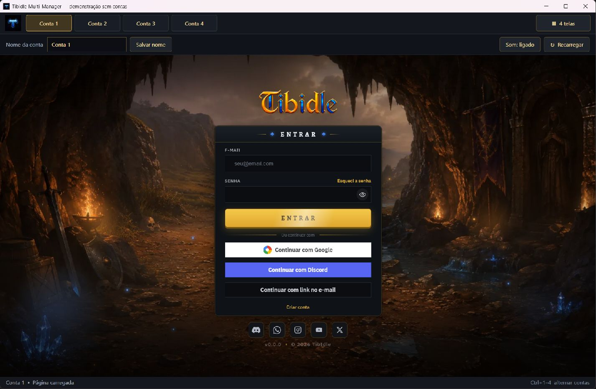

# Tibidle Multi-Manager

[](https://github.com/danbatista/tibidle-multi-manager/releases/download/v1.0.0/TibidleMultiManager-win-x64.zip)

Aplicativo de comunidade para jogar [Tibidle](https://play.tibidle.com/) no Windows com quatro contas em uma janela. Feito em C#, WPF e Microsoft Edge WebView2.

O código é aberto sob a [licença MIT](LICENSE): você pode usar, estudar, modificar e distribuir sua própria versão. Cada pessoa entra com suas próprias contas diretamente no site do jogo. Não há assinatura ou serviço próprio do gerenciador.

## Tela inicial



Captura de uma instância de demonstração com perfis novos, sem contas conectadas. Para abrir uma demonstração isolada a partir da pasta do repositório: `dotnet run --project checks/IntegrationChecks.csproj -- --preview`.

## Recursos

- Quatro abas com perfis de navegador separados.
- Logins e preferências locais persistentes entre aberturas.
- Visualização normal ou quatro telas em uma grade 2 × 2.
- Arraste das abas para reorganizar, com a mesma ordem na grade.
- Nome personalizado, som e recarregamento por conta.
- Atalhos `Ctrl+1` a `Ctrl+4`, seguindo a ordem visual.
- Troca de visualização e reorganização sem recarregar as páginas.

## Quero apenas usar

Se houver uma versão compilada na seção **Releases** deste repositório:

1. Baixe `TibidleMultiManager-win-x64.zip` da release.
2. Extraia **todo o ZIP** para uma pasta. Não execute dentro do ZIP e não separe o executável das DLLs que vêm com ele.
3. Tenha o [Microsoft Edge WebView2 Evergreen Runtime](https://developer.microsoft.com/en-us/microsoft-edge/webview2/) instalado. Caso falte, instale a versão x64 oficial.
4. Abra `TibidleMultiManager.exe`.
5. Entre nas suas contas, uma em cada aba.

O pacote gerado abaixo inclui o runtime do .NET; quem apenas usa esse pacote não precisa instalar o SDK. Uma release precisa ser criada pelo mantenedor: **Code → Download ZIP** baixa o código-fonte, não o aplicativo pronto. Se não houver release, siga a compilação abaixo.

**Destino:** Windows x64 com suporte ao .NET 10 e ao WebView2. Esta aplicação WPF não roda nativamente no Linux ou macOS. É necessária internet para jogar.

## Compilar do zero

### 1. Instale os requisitos

- [SDK do .NET 10 para Windows x64](https://dotnet.microsoft.com/en-us/download/dotnet/10.0). Escolha **SDK**, não apenas Runtime.
- [WebView2 Evergreen Runtime](https://developer.microsoft.com/en-us/microsoft-edge/webview2/), para executar e testar.
- Git é opcional: você também pode baixar o código em **Code → Download ZIP** e extrair.

### 2. Abra a pasta do código

Baixe ou clone este repositório. Abra o PowerShell na pasta que contém este `README.md`, a pasta `src` e o arquivo `LICENSE`.

Confirme a instalação:

```powershell
dotnet --list-sdks
```

Deve aparecer uma versão `10.0.x`. Não é necessário instalar o Visual Studio.

### 3. Gere o aplicativo

```powershell
dotnet restore .\src\TibidleMultiManager.csproj
dotnet publish .\src\TibidleMultiManager.csproj -c Release -r win-x64 --self-contained true -p:DebugType=None -p:DebugSymbols=false -o .\dist\win-x64
```

A restauração baixa as dependências do NuGet. A publicação gera o executável e suas dependências em `dist\win-x64`.

### 4. Abra sua compilação

```powershell
.\dist\win-x64\TibidleMultiManager.exe
```

Você pode criar um atalho desse executável no Windows. Para mover a instalação, copie a pasta inteira `win-x64`. As contas não vêm no código nem no pacote: você fará o login no primeiro uso.

### Gerar um ZIP para distribuir

O script opcional publica em uma pasta nova a cada execução, inclui a licença e a documentação e empacota somente essa saída:

```powershell
.\build.ps1
```

Resultado: `dist\TibidleMultiManager-win-x64.zip`. O script não lê a pasta dos seus perfis e não publica nada na internet. Se a política local impedir scripts PowerShell, use os comandos manuais acima. As pastas `artifacts` e `dist` são ignoradas pelo Git.

## Como usar

1. **Login:** abra cada aba e entre na conta desejada no site do jogo.
2. **Nome:** altere **Nome da conta** e clique em **Salvar nome**.
3. **Visualização:** clique em **4 telas** para a grade; **Tela normal** amplia a conta selecionada.
4. **Ordem:** arraste uma aba sobre outra. A ordem é salva imediatamente e vale na grade da esquerda para a direita, de cima para baixo.
5. **Seleção:** use a aba, o título do bloco ou clique no jogo. Som e Recarregar atuam na conta selecionada.
6. **Atalhos:** `Ctrl+1` a `Ctrl+4` selecionam as posições atuais.

Fechar o aplicativo encerra as quatro páginas, mas mantém seus dados locais. Apenas uma instância do gerenciador pode ficar aberta por usuário do Windows.

## Dados das contas

Os dados ficam **fora do repositório e da pasta do executável**, em:

```text
%USERPROFILE%\.tibidle-multi-manager\
├── settings.json       # nomes, ordem, som e visualização
└── BrowserData\        # cookies, armazenamento do site e perfis
```

Cada conta usa um identificador fixo (`Account1` até `Account4`). Renomear ou arrastar uma aba não altera esse identificador nem transfere o login.

O código do gerenciador não captura sua senha nem a grava em `settings.json`. O site e o navegador mantêm dados de autenticação no perfil, como em um navegador normal. **A pasta de perfis é privada e não deve ser compartilhada.**

Para sair de uma conta, use a opção de sair do próprio jogo. Para atualizar, substitua os arquivos de instalação com o aplicativo fechado e preserve a pasta de dados. Apagar essa pasta remove logins e preferências locais.

## Desenvolvimento e testes

Execute durante o desenvolvimento:

```powershell
dotnet run --project .\src\TibidleMultiManager.csproj
```

Verificações disponíveis:

```powershell
dotnet run --project .\checks\IntegrationChecks.csproj
dotnet run --project .\checks\IntegrationChecks.csproj -- --layout
dotnet run --project .\checks\IntegrationChecks.csproj -- --order
dotnet run --project .\checks\IntegrationChecks.csproj -- --check-data-root
dotnet run --project .\checks\IntegrationChecks.csproj -- --game-smoke
```

Os testes usam perfis temporários separados das contas pessoais. Verificam isolamento de cookies e armazenamento, preferências, grade, ordem e preservação das páginas ao reorganizar. O teste `--game-smoke` acessa o site real sem efetuar login e exige internet. Não valida ações do jogo nem continuidade da sessão em segundo plano. Arquivos de teste podem permanecer na pasta temporária do Windows.

### Organização do código

| Arquivo | Responsabilidade |
| --- | --- |
| `src/MainWindow.xaml` | Interface |
| `src/MainWindow.xaml.cs` | Abas, controles, arraste e janelas auxiliares |
| `src/BrowserSession.cs` | Navegadores e perfis |
| `src/SettingsStore.cs` | Configurações e identidades das contas |
| `src/BrowserLayout.cs` | Tela única e grade |
| `src/TabOrder.cs` | Ordem visual |
| `checks/Program.cs` | Verificações executáveis |

Faça um fork e adapte a interface e o comportamento ao seu gosto. Ao mudar o layout, mantenha os identificadores dos perfis estáveis para preservar as contas existentes.

## Publicar seu fork ou uma release

O `.gitignore` exclui compilações, perfis, sessões, configurações pessoais, bancos locais, logs, atalhos, credenciais e anotações locais. Ele não remove arquivos já commitados nem identifica todo segredo possível pelo conteúdo.

Revise o que vai entrar no Git:

```powershell
git status --short
git diff --cached --stat
git diff --cached
git ls-files
```

Não use `git add -f` em arquivos privados. Nome e e-mail do autor também fazem parte dos commits: configure sua identidade pública antes de criar commits. Para distribuir binários, use uma compilação nova ou `build.ps1`; nunca compacte a pasta de usuário, os perfis ou todo o diretório de trabalho.

## Limitações e solução de problemas

- **WebView2 não inicia:** instale ou repare o Evergreen Runtime pelo link oficial acima.
- **Aplicativo já aberto:** procure a janela na barra de tarefas.
- **Login expirou:** o servidor pode exigir novo login mesmo com o perfil salvo.
- **Google, Discord ou CAPTCHA:** o provedor pode impor requisitos próprios para navegadores embutidos; faça as verificações solicitadas pelo site. Não há automação dessas etapas.
- **Segundo plano:** manter as páginas abertas não garante que o jogo execute da mesma forma quando oculto ou minimizado; isso depende do jogo e do navegador.
- **Memória:** são quatro páginas do jogo. A interface é compacta, mas não elimina o consumo delas.

## Licença e créditos

O código deste gerenciador é distribuído sob a [MIT](LICENSE), sem restrições adicionais de uso ou modificação impostas pelo projeto. Preserve o aviso de copyright e a licença nas cópias, conforme o texto da MIT.

Este é um projeto de comunidade, sem afiliação oficial declarada com o Tibidle. O jogo, sua marca, imagens e dependências de terceiros têm titularidade própria. Veja [os avisos de terceiros](THIRD_PARTY_NOTICES.md). A MIT do gerenciador não altera as condições do serviço do jogo.
